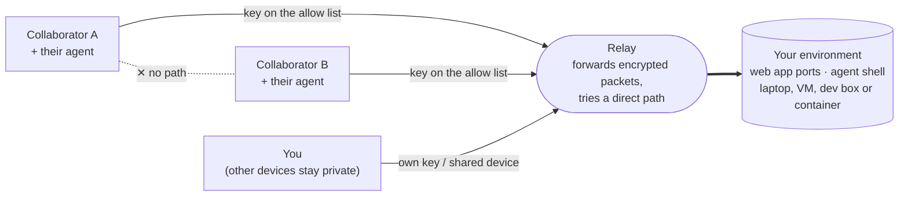

# tailshare

Share your dev environment with people and their AI agents over a private
WireGuard tunnel: no public IP, no port forwarding, no server of your own.

Ask your agent things like:

- "Let Alice see the app on port 3000."
- "Let Bob's agent SSH in and fix the failing test."
- "Connect me to the environment Carol sent me: tc..."
- "Set up a shared workspace my teammates can use without seeing my other devices."

It picks the right tool for the job:

- **[Tailcat](https://github.com/tailscale/tailcat)**: no accounts, one command
  on each side, and it can even run in a browser as WebAssembly. Good for
  ad-hoc sharing with anyone.
- **[Tailscale](https://tailscale.com)**: stable names, ACLs, phone apps, and
  public HTTPS via Funnel. Good for ongoing teams.

Then it runs the commands with safe defaults: an allow-list of keys,
explicit ports, and no public addresses.

## Install

Claude Code (as a plugin):

```
/plugin install tailshare --marketplace JerryChaox/tailshare
```

On older Claude Code, run `/plugin marketplace add JerryChaox/tailshare`
first, then `/plugin install tailshare@tailshare`.

Other agents that read `SKILL.md` skills: copy
[`skills/tailshare`](skills/tailshare) into that agent's skills folder.

You also need `tailcat` (`brew install tailcat`; other platforms are listed in
[tailcat.md](skills/tailshare/references/tailcat.md)) and/or `tailscale`.

## How it works

The environment is the hub. People and their agents connect to it, never to
each other, and a WireGuard key is their identity.



1. **Join:** the guest makes a key pair and sends you only the public half
   (Tailcat `nodekey:...`), or signs in with their Tailscale account.
2. **Allow:** you add that key to `--allow` (Tailcat), or grant that user one
   port on the workspace (Tailscale policy).
3. **Connect:** both sides dial out to a relay, so nothing listens on the
   internet. The WireGuard handshake needs the matching private key, so a
   copied public key can't impersonate anyone.
4. **Work:** everyone reaches the same app and sessions, so they all see the
   same state. The app can tell who is connected from the key, with no extra
   login.

| | Tailcat | Tailscale |
|---|---|---|
| Identity | client key `nodekey:...` | account + device |
| Who gets in | `--allow` list, SSH keys | policy grants |
| Invite | send the `tc...` address, add their key | invite to a team tailnet |
| Isolation between guests | built in (no tailnet) | grant nothing between them |
| Best for | ad-hoc, no accounts, browser-only guests | ongoing teams, phones, fine-grained policy |

## Repository layout

```
.claude-plugin/        plugin and marketplace manifests
skills/tailshare/      the agent skill
  SKILL.md             which tool to use, share/join recipes, safety rules
  references/
    tailcat.md         commands, keys, stable addresses, gotchas
    tailscale.md       serve, funnel, node sharing, SSH, the team-workspace pattern
    browser.md         opening a shared web app from a browser, nothing installed
```

More (a CLI, a browser opener) will land in their own top-level folders.

Not affiliated with Tailscale. MIT licensed.
